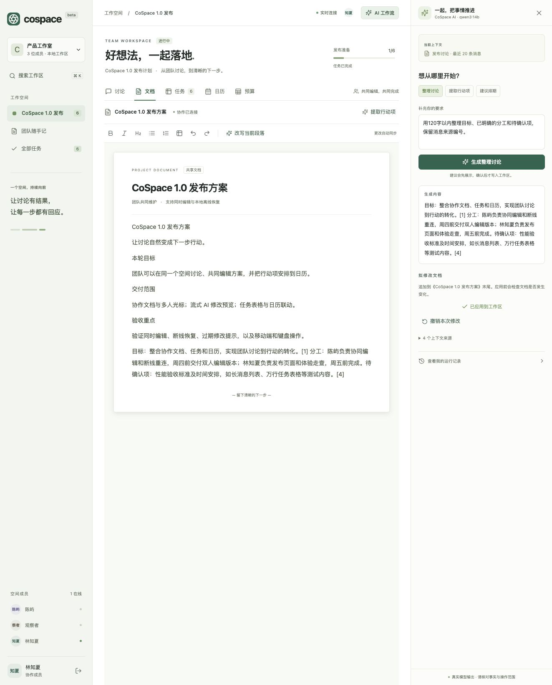

# CoSpace

CoSpace 是一个可以实际运行的 AI 团队协作工作台。讨论、协作文档、任务、日历与预算共用一个工作区；AI 在现有工作流中提出修改，经过预览和确认后写入，并支持有条件撤销。

项目为独立作品集项目，使用真实 PostgreSQL、WebSocket、Yjs 和本地模型。它不是某公司的生产项目，也没有虚构用户量或业务增长数据。



## 快速启动

要求 Node.js 22.13+、npm、Docker。AI 使用本机 Ollama，普通协作功能不依赖模型启动。

```bash
git clone https://github.com/thunderxu7-sketch/cospace.git
cd cospace
npm ci
npm run db:up
npm run dev
```

浏览器打开 **http://127.0.0.1:3027**。选择林知夏、陈屿或只读观察者；用普通窗口与无痕窗口/不同浏览器模拟两个身份。同一浏览器配置中的窗口共享登录 Cookie。

默认端口：网页 `3027`，API/业务 WebSocket `4027`，Yjs 协作 `4028`，独立 PostgreSQL `55437`。所有服务绑定回环地址，不会覆盖已有项目的数据库。

模型准备：

```bash
ollama pull qwen3:14b
# 如果 Ollama 桌面应用未运行：
ollama serve
```

默认模型为 `qwen3:14b`。可复制 `.env.example` 为 `.env.local` 修改模型或数据库；启动脚本会读取配置。模型不可用时显示错误，不以预设文本冒充生成结果。

生产模式本地验证：

```bash
npm run build
npm start
```

`Ctrl+C` 停止网页、API 和协作进程。`docker compose stop` 停止本项目数据库，数据仍保存在独立卷中。

## 已实现

| 模块         | 可以验证的行为                                                                                                         |
| ------------ | ---------------------------------------------------------------------------------------------------------------------- |
| 团队聊天     | WebSocket 更新、在线成员、回复、发送中/失败状态、相同请求重试去重、历史分页、动态高度虚拟列表                          |
| 文档与随手记 | Tiptap 富文本、表格、多人光标、Yjs 合并、IndexedDB 缓存、已打开页面的离线编辑和重连同步                                |
| 任务表格     | 单元格编辑、状态/成员/优先级/截止日期、中文筛选、排序、多行粘贴创建、虚拟滚动、乐观更新、版本冲突提示                  |
| 团队日历     | 同一份任务数据、拖动与调整时长、弹窗排期、独立的截止日期和安排时段、同一成员时间冲突提示                               |
| 预算表       | Univer 真正的电子表格、乘法与 SUM 公式、复制粘贴、JSON 副本导出、持久化和保存版本冲突提示                              |
| AI 工作流    | 讨论纪要、文档行动项、段落改写、发布周排期；真实流式输出、取消、来源快照、预览、确认、放弃、运行历史、受版本保护的撤销 |
| 体验与权限   | 响应式布局、键盘快捷键、对话框焦点管理、编辑者/观察者角色、服务端写权限和来源校验                                      |

AI 修改文档时检查完整内容及格式的哈希；修改任务时检查版本。撤销会拒绝覆盖之后的协作修改。文档操作还把执行回执与修改一起写入 Yjs，避免数据库提交失败后的重试再次追加内容。

## 验证

```bash
npm run check                    # 类型、单元测试、生产构建
npx playwright install chromium firefox webkit
npm run test:e2e                 # 真实浏览器与接口、万行渲染回归
npm run test:ai                  # 真实本地模型：生成 → 应用 → 撤销、取消
npm run format:check
```

测试需要本项目数据库。端到端测试仅创建并清理带唯一标记的测试数据；应在本地演示工作区运行。真实模型测试消耗本机算力，保留运行记录并撤销其业务修改。

- [架构与取舍](docs/ARCHITECTURE.md)
- [五分钟演示与岗位对应](docs/DEMO.md)
- [验证结果与边界](docs/VALIDATION.md)

## 当前范围

这是本地单工作区 MVP：演示身份、固定的 2026 年 11 月发布场景、单进程协作服务。预算采用手动保存与版本校验，目前不支持多人同时编辑同一单元格。重连后的消息与任务通过重新获取服务器快照恢复；文档通过 CRDT 合并恢复。

后续产品化阶段包括正式身份系统、多工作区隔离、HTTPS/WSS 与部署配置、跨进程事件与协作服务、审计保留策略、文档历史/评论、预算协同与 Excel 导入导出。第三方画布电子表格的完整读屏能力仍需专项验证。
