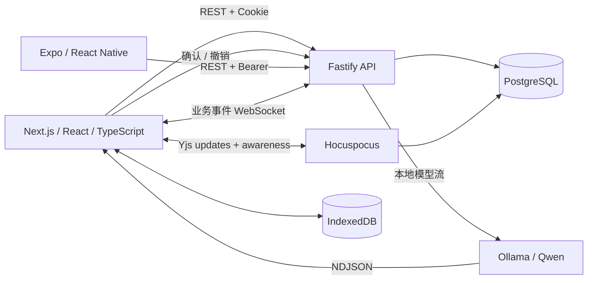
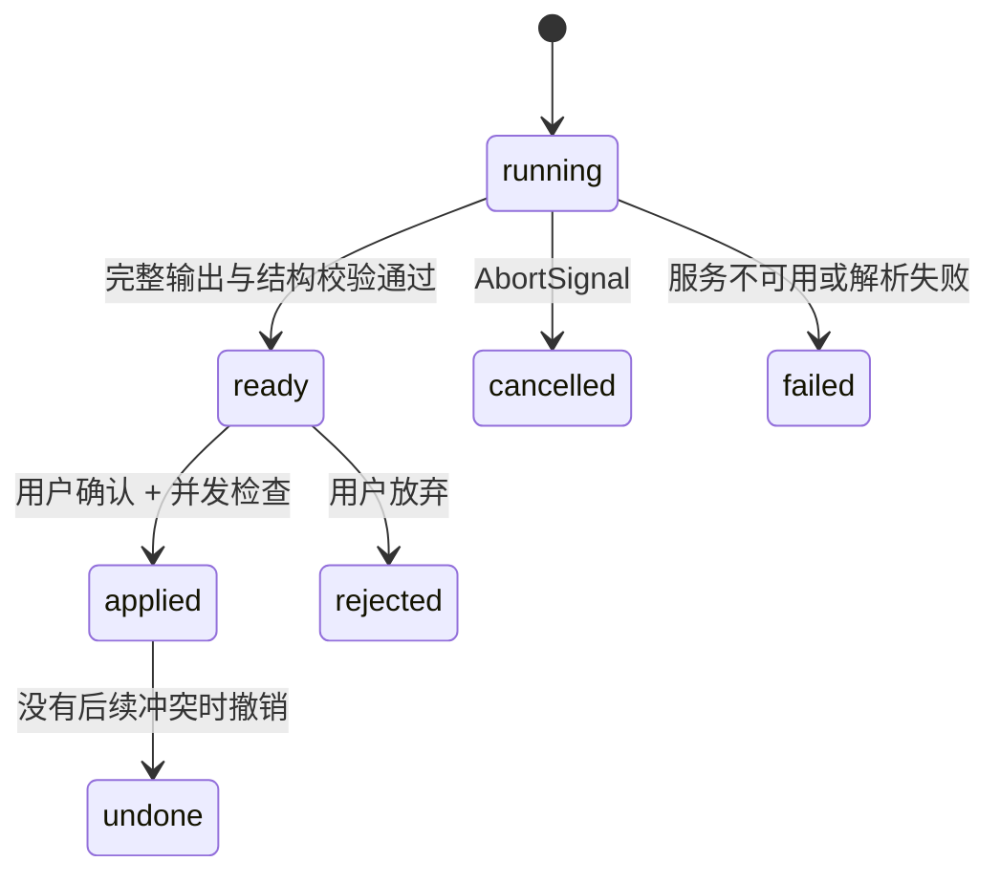

# 架构与实现取舍

## 一条可演示的工作流

团队在讨论中形成决定 → AI 依据消息生成带来源的纪要 → 人确认后追加到共享文档 → AI 从文档提取行动项 → 确认后创建真实任务 → 同一任务在表格和日历中编辑 → 预算表估算投入。

## 状态归属

| 状态                 | 归属                         | 理由                                           |
| -------------------- | ---------------------------- | ---------------------------------------------- |
| 当前视图、弹窗、草稿 | React 本地状态               | 只影响当前用户的操作                           |
| 消息、任务、成员     | PostgreSQL + TanStack Query  | 服务器是最终来源，支持失败恢复和乐观更新       |
| 文档内容             | Yjs 文档                     | 字符级并发合并、离线重连不丢失另一位作者的修改 |
| 光标和在线状态       | awareness / WebSocket        | 短暂状态，无需作为业务数据永久保存             |
| 预算                 | Univer 工作簿 + 带版本的快照 | 公式由真实引擎计算，显式保存并检查并发冲突     |
| AI 建议与运行历史    | `runs` 表                    | 生成过程与业务写入分开，能取消、审阅和追踪     |

编辑器、日历、电子表格按需加载，避免首屏承担所有重型库。消息和任务表只挂载可见范围及少量额外行。

## 聊天与事件恢复

客户端为发送请求生成 UUID；数据库对 `(user_id, client_id)` 建立唯一约束。服务器已收到但客户端未收到响应时，重试返回同一消息。任务创建使用相同思想，并在事务内取得请求锁。

业务写入成功后发送事件，客户端重新获取查询数据。WebSocket 断开后指数退避重连；重新连接收到 `refresh`，获取最新服务器快照。这里没有宣称可靠事件回放或 exactly-once 消息投递；丢失通知时通过快照恢复业务状态。

## 文档协作

`Tiptap + Collaboration + CollaborationCaret` 映射 Yjs XML 结构。Hocuspocus 鉴权后允许编辑或只读同步，文档更新保存为 PostgreSQL 二进制状态。IndexedDB 保存客户端缓存，已打开的页面断线后可继续编辑，重连交换 CRDT 更新。

数据库中的初始内容只在文档尚无状态时写入，客户端不各自填入默认内容。服务端 AI 使用 Hocuspocus 的 direct connection 修改同一份活动文档。

AI 文档操作以完整 XML 的哈希为前置条件，格式变化也会使旧建议失效。执行回执存在同一 Yjs 事务的 `operations` map 中；再次应用同一个运行 ID 时返回回执。撤销仅恢复本次涉及的段落，并要求修改后的文档哈希仍匹配，避免破坏后续协作。

## 任务与排期一致性

任务持有整数 `version`。更新携带读取时的版本，在事务中锁行并比较；冲突返回 409 和当前任务，前端刷新并解释原因。任务名称、状态、截止日期和安排时段都属于同一实体。

`due_at` 表示截止时间，`start_at/end_at` 表示实际排期，拖动日历不会覆盖截止日期。AI 批量排期在单个数据库事务中检查所有版本及同一负责人的重叠时段，任何冲突使整批回滚。手工排期允许用户明确安排，并展示重叠提示。

## AI 运行状态与操作边界

生成端保存上下文来源快照。任务与排期要求 JSON，解析和检查通过后才出现可应用操作；自然语言纪要/改写只作为文本处理。流式解析器处理分片 UTF-8 字符及不完整 NDJSON 行，未收到完整结束事件不会伪装成成功。

服务端用 AbortSignal 取消上游模型请求；超时、连接提前结束、无内容和无效结构均显示失败。服务重启后把未完成运行标为失败。

每次应用锁定运行行：任务创建和排期连同运行状态在同一 PostgreSQL 事务提交；文档额外依赖 CRDT 中的执行回执补偿跨存储边界的重试。任务撤销检查新建任务版本仍为 1；排期撤销检查应用后版本未变化。

## React Native 行动项审阅

已登录的网页为当前账号签发一次性配对码。手机兑换后，将有效期为 24 小时的独立令牌保存到系统安全存储。服务端原子消费配对码，只保存凭据的摘要，并在每次请求时检查会话有效期。Web 写操作继续校验 Cookie 和 Origin。移动会话仅能调用指定的审阅、读任务和改状态接口。

两端使用同一份行动项建议、来源快照、任务和确认回执。应用建议时，服务端把任务、运行状态和事件记录放在同一事务中，提交后推送 WebSocket 通知。重复确认会返回之前的任务 ID。手机发送确认前保存待核对的运行 ID，重连或重启后先查服务端状态，等读回结果后再更新界面。

手机待确认列表在前台可见时轮询，切回前台、恢复网络和手动下拉都会触发查询。任务与建议用时间和 ID 作为游标分页，列表用原生 `FlatList` 渲染。进程存活期间缓存已读内容，断线时可以查看上次获取的内容。切换会话后创建新的查询缓存。[移动端开发计划](REACT_NATIVE_PLAN.md)

## 本地范围与扩展点

- HttpOnly、SameSite Cookie，写操作校验 Origin；后端校验只读角色。演示账号按钮仅适合回环地址的作品集运行。
- 单工作区和单协作进程。目前没有分布式锁、跨节点广播或租户级隔离。
- 有事件日志和 AI 运行历史，尚未接入正式指标/日志平台，也没有日志保留和 CRDT 压缩策略。
- 预算快照按版本保存，保存前等待公式结果落入模型。它不使用文档的 CRDT 协作通道。
- REST 已覆盖当前业务契约，未为展示技术栈额外复制 GraphQL API。
